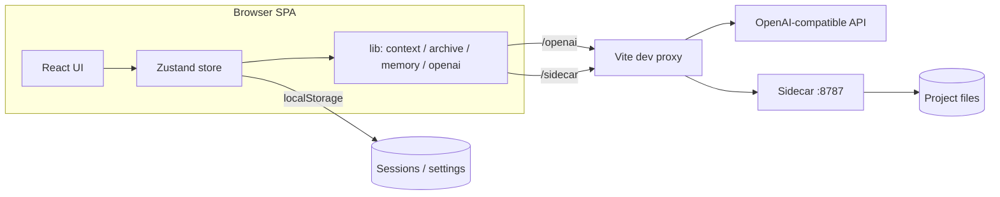
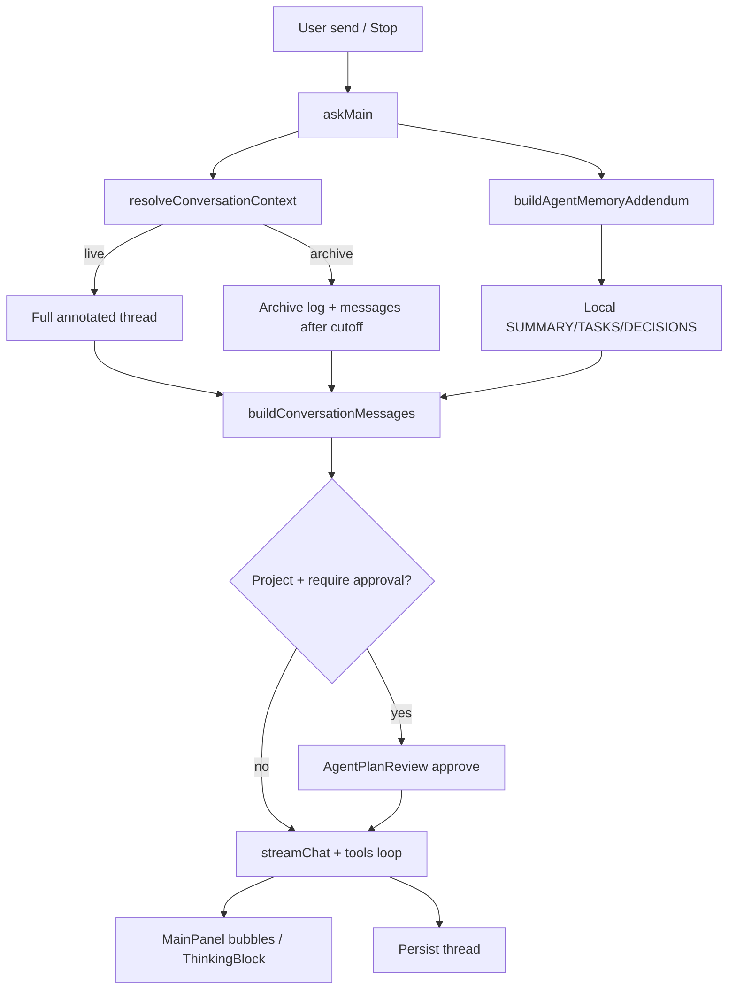

# ForkNote

面向开发与排障的「边读边澄清、再归档成日志」的工作台。

**Clarify as you read** — 针对 AI 长回答的选中澄清工具。

拖选一段文字 → **Clarify this** → 浮动澄清面板与 Fork 分支回答；对分点打 **Accept / Reject / Doubt**；右侧 **Branch rail** 导航；可选绑定本机目录做读写。

- 纯 Web（Vite + React）
- OpenAI 兼容 API（云端或本机 Ollama / LM Studio 等）
- **多笔记**：左侧列表新建 / 重命名 / 切换 / 删除
- 无登录；笔记与设置保存在浏览器 `localStorage`

仓库已开启 GitHub **Automatically delete head branches**：PR 合并进 `leading` 后会自动删除远端 head 分枝，避免 `pr/*` 堆积。


---

## 安装与运行

需要 **Node.js ≥ 18**（Vite 6 要求）。

```bash
npm install
npm run dev                  # 同时启动 Vite + sidecar；Ctrl+C 一起停
```

浏览器打开 http://127.0.0.1:5173 。首次使用请在 **系统设置 → API** 配置模型并 **保存**。

| 脚本 | 作用 |
|------|------|
| `npm run dev` | **推荐**：Vite + sidecar 一起启动；若 `:8787` 已有健康 sidecar 会复用，不因端口占用直接崩溃 |
| `npm run dev:web` | 仅 Vite（会在需要时自动拉起 sidecar） |
| `npm run sidecar` | 仅 sidecar（`127.0.0.1:8787`）；已在跑且 `/health` 正常时直接退出 0 |
| `npm run build` | 类型检查 + 生产构建 |
| `npm run preview` | 预览构建产物 |

若启动失败（常见原因：端口被占用）：

```bash
# 看谁占用了 8787 / 5173
lsof -nP -iTCP:8787 -sTCP:LISTEN
lsof -nP -iTCP:5173 -sTCP:LISTEN
# 确认 sidecar 是否健康
curl -sS http://127.0.0.1:8787/health
```

---

## 系统设置

侧栏打开 **Settings**（系统设置），左侧分类：

| 分类 | 内容 |
|------|------|
| **General** | 主题 Light / Dark / System；界面语言 English / 中文（模型回复语言跟随） |
| **API** | 提供商预设、Base URL / Model / Key、开发代理；本地上下文记忆包 |
| **Data** | 导出 / 导入笔记 JSON；清空本地笔记 |
| **Project** | Sidecar URL、打开本地项目、Agent 工具轮数 / 计划批准 |
| **About** | 产品说明 |

### API

1. 首次使用 **Base URL / Model 为空**，无内置默认提供商；点提供商预设（云端 / 国内 / 本机等分组，如 **OpenAI**、**DeepSeek**、**Ollama**），或手动填 **Base URL** / **Model** / **API Key**
2. **系统设置 → API** 是所有笔记的**默认**连接配置。新建笔记继承这些默认值（不写快照）；需要时可在输入框旁打开 **会话 API 设置**，按笔记覆盖 Base URL / Key / Model / 代理，并可「恢复默认」
3. 本机服务一般 **API Key 留空**；云端填控制台密钥
4. 开发时勾选 **Use local proxy in development**（推荐）：请求走 `/openai/...`，由 Vite 按当前 Base URL 转发，减轻 CORS
5. **Save** 保存（亦写入 `localStorage`）

| 常见本机 | Base URL | Model 示例 |
|----------|----------|------------|
| Ollama | `http://127.0.0.1:11434` | `qwen2.5-coder:7b`、`llama3.2`（须与 `ollama list` 一致） |
| LM Studio | `http://127.0.0.1:1234` | Local Server 里显示的名称 |

自测 Ollama：

```bash
curl http://127.0.0.1:11434/v1/chat/completions \
  -H "Content-Type: application/json" \
  -d '{"model":"llama3.2","messages":[{"role":"user","content":"hi"}],"stream":false}'
```

curl 成功而页面失败时，核对 Model 名、端口、是否启用代理。

---

## 主对话

1. 在输入框提问 → **Send**（`Enter` 发送，`Shift+Enter` 换行）
2. 生成中按钮变为 **Stop**：中止流式输出
3. **Stop** 后，刚才发出的提示会 **恢复到输入框**，便于改写再发
4. 有对话后，底部为紧凑续写框；空笔记页有「Clarify as you read」引导

---

## 归档与上下文模式

澄清与分点裁决完成后，可把主线压成一篇开发日志草稿，再选上下文继续聊：

1. 输入区上方工具栏点 **Archive** → 模型根据主线 + 裁决 + 澄清整理 Markdown 日志
2. 同排分段控件：**Archive context**（以日志为底座，只附归档之后的新消息）/ **Full thread**（整条 thread）
3. 提示文案在按钮上方，避免切换模式时工具栏跳动；生成中可用 **Stop** 取消
4. 多篇归档时在归档面板中选用

---

## 选中澄清与 Fork 面板

1. 在助手回答中 **拖选** 一段文字
2. 出现工具条 → 点 **Clarify this**
3. 弹出 **Clarify selection**：简短说明哪里不清 → **Submit**
4. 澄清回答以浮动 **Fork** 面板挂在选区附近；可继续在分支里选中澄清（嵌套）
5. 关闭面板或点 Branch rail / 评论轨上的节点，可重新打开对应分支

绑定本地项目后，Clarify / Fork 可使用与主对话相同的工具、多轮循环与计划批准（底部 Approve & run）；回答仍写入 Fork 分支，不会改写主线。

---

## 分点裁决（Point verdicts）

当回答含至少两个 `【1】【2】…` 分点时，每点旁可裁决：

| 操作 | UI | 含义（进入后续上下文） |
|------|-----|------------------------|
| 默认 / **Accept** | 未点或采纳 | 视为已采纳，正文保留 |
| **Reject** | 拒绝 | 后续对话省略该点正文 |
| **Doubt** | 存疑 | 保留正文；可填 **Doubt note** |

未标记的点按 **采纳** 处理。裁决会影响后续主对话 / 澄清的上下文组装。

---

## Branch rail

主回答右侧为 git-graph 风格的 **Branch rail**：

- 主干对齐各条助手消息；Fork 节点按深度向右展开
- 点击节点可聚焦 / 打开对应浮动分支面板
- 与左侧评论轨、浮动层配合，用于在长回答里跳转澄清分支

---

## 打开项目与 Agent 工具

主对话可绑定本机目录，模型通过工具 **列出 / 读取 / 写入 / 搜索** 文件（路径限制在项目根内）。**每个聊天会话独立绑定项目**：切换会话会保存并恢复该会话自己的项目根（或未绑定）；打开 / 断开只影响当前会话。

### 步骤

1. 运行 `npm run dev`（已包含 sidecar；也可分开跑 `npm run sidecar` + `npm run dev:web`）
2. 侧栏或输入区上方点 **Open project** → 对话框 **Local project**
3. **Sidecar URL** 默认 `/sidecar`（经 Vite 代理）；填项目 **绝对路径** → **Connect**
4. 绑定写入当前会话（`forknote-sessions-v1` 的 `projectRoot`）；对话框草稿路径仍可记在 `forknote-project.lastPath`，但不驱动状态栏跨会话显示
5. **Disconnect** 解除**当前会话**的绑定

### Agent 工作流（绑定项目后）

主对话在已连接项目时会进入 **多轮工具循环**（模型 ↔ sidecar 工具往返，任务完成可提前结束）：

1. **计划批准（默认开启）**：Settings → **Project** → **执行工具前需批准计划**。开启后，模型先输出执行计划；输入区上方出现 **AgentPlanReview** 栏，点 **批准并执行** 才读写文件，**取消** 丢弃本轮。
2. **工具轮数**：同页 **Agent 工具循环轮数** 可调（1–64，**默认 20**），控制单条消息内最多往返次数。
3. 关闭计划批准后，模型会直接调用工具（仍受轮数上限约束）。

活动日志与 **Changes this turn** 显示本轮读/写过的路径；可 **Clear log**。

### 工具能力

| 工具 | 作用 |
|------|------|
| `list_dir` | 列目录 |
| `read_file` | 读文本（有大小上限） |
| `write_file` | 覆盖写入 UTF-8 文本文件（源码、md、csv、json 等） |
| `search_replace` | 精确替换已有文本文件中的片段（优先用于小改动） |
| `apply_patch` | 对同一文件顺序应用多处 `search_replace` |
| `write_docx` | 生成真实 Word `.docx`（`title` + `paragraphs`） |
| `write_xlsx` | 生成真实 Excel `.xlsx`（`rows` 二维数组） |
| `mkdir` | 创建目录 |
| `search_files` | 简单全文搜索 |

示例提问：

> 读取 package.json，并在 README.md 顶部加一行说明本项目用途

### Sidecar HTTP（`127.0.0.1:8787`）

| Method | Path | 说明 |
|--------|------|------|
| `POST` | `/project/open` | `{ "path": "/abs/project" }` |
| `POST` | `/project/pick-folder` | 本机原生文件夹对话框 → `{ "path", "cancelled" }` |
| `GET` | `/project` | 当前根目录 |
| `POST` | `/project/close` | 解除绑定 |
| `GET` | `/fs/list?path=` | 列目录 |
| `GET` | `/fs/read?path=` | 读文件 |
| `POST` | `/fs/write` | `{ "path", "content" }` 文本 |
| `POST` | `/fs/search_replace` | `{ "path", "old_string", "new_string", "replace_all?" }` |
| `POST` | `/fs/apply_patch` | `{ "path", "edits": [{ "old_string", "new_string", "replace_all?" }] }` |
| `POST` | `/fs/write_docx` | `{ "path", "title?", "paragraphs": string[] }` |
| `POST` | `/fs/write_xlsx` | `{ "path", "sheet_name?", "rows": cell[][] }` |
| `POST` | `/fs/mkdir` | `{ "path" }` |
| `POST` | `/fs/search` | `{ "query", "path?" }` |
| `GET` | `/health` | 探活 |

安全：拒绝 `..` 与绝对路径逃逸；FS 操作必须落在绑定根下。

---

## 主题与笔记

- **Light / Dark / System**：系统设置 General 或侧栏；偏好键 `forknote-theme`
- **New note**：新建空笔记
- **重命名**：双击笔记标题，或菜单里重命名；手动命名后标题不再被首条消息自动覆盖
- **删除**：笔记菜单删除（数据在本地，无云端回收站）
- 笔记按日期分组显示在左侧

---

## API 与模型（系统设置 → API）

在应用内配置即可，**不需要** `.env` 或 `VITE_OPENAI_*` 等环境变量（见 `.env.example` 说明）：

| 项 | 说明 |
|------|------|
| Base URL | 如 `https://api.deepseek.com` 或本机 `http://127.0.0.1:11434` |
| API Key | 云端必填；本机 Ollama 通常留空 |
| 模型 | 系统设置为默认；每条笔记可在「会话 API 设置」覆盖。示例：`deepseek-v4-flash`（DeepSeek 官方）、`deepseek-ai/DeepSeek-V4-Flash`（SiliconFlow）、`qwen2.5-coder:7b`（Ollama） |
| 本地代理 | 开发时建议开启，请求经 `/openai` 转发到你填写的 Base URL |

配置保存在浏览器 `localStorage`（`forknote-settings`），换浏览器或清缓存后需重新填写。

**模型名须与 Base URL 所属平台一致**（例如 DeepSeek 官方用 `deepseek-v4-flash`，SiliconFlow 用 `deepseek-ai/DeepSeek-V4-Flash`）。混用会导致 404。可点提供商预设自动填入匹配的 Base URL + 模型。

生产构建（`npm run build`）部署到静态站时，需自行配置反向代理，或关闭代理并确保 API 允许跨域。

---

## 上下文记忆包（本地）

目标流水线：

```
聊天记录
  → LLM 压缩（Compress / 可选归档后自动）
  → SUMMARY.md + TASKS.md + DECISIONS.md
  → 下次 askMain 自动注入 system 附加段
```

### 怎么用

1. 聊几轮后点输入区上方 **Compress context**（或 Settings → API 勾选 **Also compress after Archive**）
2. **已绑定项目**：写入 `{memoryDir}/`（默认 `.forknote/memory/`）三份 Markdown  
   **未绑定项目**：草稿保存在当前笔记的 `contextMemory`（localStorage）
3. 下次主对话发送前，会把相关摘录（本地关键词筛选）注入上下文
4. Settings → API → **Context memory pack**：注入开关、归档后压缩、记忆目录

实现：`src/lib/contextMemory.ts` + `compressContext`（store）。压缩提示与归档类似，复用 `streamChat`。

长期记忆统一走上述本地三文件；不使用云端 mem0。当前本地层是三文件 + 关键词摘录（非向量库）。

---

## 软件架构

ForkNote 是浏览器端 SPA + 可选本机 sidecar。无自有后端；对话状态与设置落在 `localStorage`，LLM 走 OpenAI 兼容 HTTP，项目文件经 sidecar 受限访问。

### 运行时拓扑



### 主对话数据流



### 分层与职责

| 层 | 位置 | 职责 |
|----|------|------|
| **UI** | `src/components/` | 会话壳、主聊天、澄清浮层、Branch rail、系统设置、归档面板 |
| **状态** | `src/store/useAppStore.ts` | 会话 CRUD、`askMain` / `askBranch`、归档 / 压缩、项目绑定、生成中止 |
| **领域 lib** | `src/lib/` | 上下文组装、裁决标注、流式协议、agent 工具、记忆、i18n、主题 |
| **持久化** | `storage.ts` / `settings.ts` / `theme.ts` | `localStorage` 笔记、API、主题、语言 |
| **Sidecar** | `sidecar/index.js` | 本机项目根绑定与受限 FS HTTP |
| **代理** | `vite.config.ts` | 开发期 `/openai`（按 `X-Forknote-Target` 动态转发）、`/sidecar` |

### 核心模块

| 模块 | 文件 | 说明 |
|------|------|------|
| 主聊天壳 | `MainPanel.tsx`、`ChatComposer.tsx` | 消息列表、footer 工具栏（项目 / 上下文模式 / Archive / Compress）、DeepSeek 风格气泡 |
| 澄清 / 分点 | `SelectableMarkdown.tsx`、`PointizedAnswer.tsx`、`FloatingAskPanel.tsx` | 选中澄清、分点 Accept/Reject/Doubt |
| 分支导航 | `BranchRail.tsx`、`BranchFloatLayer.tsx` | git-graph 轨与浮动 Fork |
| 上下文 | `conversationContext.ts`、`contextBuilder.ts`、`points.ts` | live vs archive；system + 历史；裁决注入 |
| 归档 | `archive.ts`、`ArchivePanel.tsx` | 开发日志草稿与面板 |
| 记忆包 | `contextMemory.ts` | Compress → 三 MD；`askMain` 注入 |
| 推理展示 | `openai.ts`、`reasoning.ts`、`ThinkingBlock.tsx` | 仅在有真实 reasoning 时显示 |
| Agent 工具 | `agentTools.ts`、`sidecar.ts` | `list_dir` / `read_file` / `write_file` / …；多轮循环 + 计划批准门控 |
| 计划审核 | `AgentPlanReview.tsx` | 绑定项目且开启批准时，工具执行前的计划审阅栏 |
| 设置 / i18n | `SettingsPanel.tsx`、`i18n.ts`、`theme.ts` | 系统设置；EN/ZH；主题 |
| 类型 | `types.ts` | `ChatSession`、`ThreadRoot`、归档、记忆包等 |

### 持久化键（摘要）

| 键 / 位置 | 内容 |
|-----------|------|
| `forknote-sessions-v1` | 多笔记、thread、archives、contextMemory、每会话 `projectRoot` / 可选 `api` 覆盖 |
| `forknote-settings` 等 | API、代理、本地记忆包开关 |
| `forknote-theme` / `forknote-locale` | 主题与界面语言 |
| 项目偏好 | 上次项目路径、sidecar URL |
| 磁盘 `.forknote/memory/` | 绑定项目后的 SUMMARY / TASKS / DECISIONS |

### 项目结构

```
sidecar/                 # 本机 FS sidecar（Node HTTP :8787）
public/                  # favicon 等
src/
  App.tsx                # 壳：侧栏 + 主区 + 设置 / 项目 / 归档浮层
  main.tsx
  types.ts
  components/            # UI（见上表）
  lib/                   # 协议与领域逻辑（见上表）
  store/useAppStore.ts   # 唯一应用状态入口
  index.css              # 设计 token 与布局
vite.config.ts           # 开发代理
```

### 设计约束（现行）

- **本地优先**：笔记与记忆包默认留在本机；LLM 云 API 为可选配置
- **上下文显式**：Full thread / Archive / 记忆包注入路径可预期，避免「假记忆」
- **工具隔离**：项目工具仅主对话；路径相对项目根，sidecar 防逃逸
- **推理诚实**：无 `reasoning` / think 标签则不展示思考 UI
