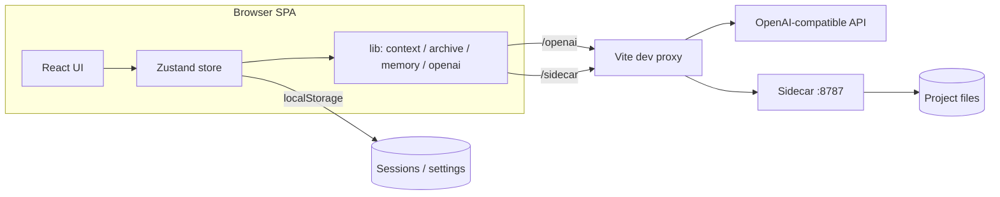
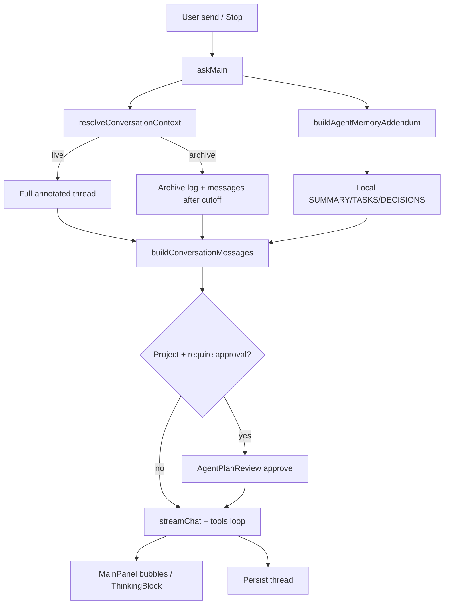

<div align="center">

# ForkNote

[](https://github.com/y-Adrian/forknote/actions/workflows/ci.yml)

</div>

面向开发与排障的「边读边澄清、再归档成日志」的工作台。

**Clarify as you read** — 针对 AI 长回答的选中澄清工具。

拖选一段文字 → **Clarify this** → 浮动澄清面板与 Fork 分支回答；对分点打 **Accept / Reject / Doubt**；右侧 **Branch rail** 导航；可选绑定本机目录做读写。

- 纯 Web（Vite + React）
- OpenAI 兼容 API（云端或本机 Ollama / LM Studio 等）
- **多笔记**：左侧列表新建 / 置顶 / 分享 / 重命名 / 切换 / 删除
- 窄屏（≤768px）：侧栏完全收起，主区品牌 Logo 打开会话列表抽屉（DeepSeek 风格）
- 无登录；笔记与设置保存在浏览器 `localStorage`

仓库已开启 GitHub **Automatically delete head branches**：PR 合并进 `leading` 后会自动删除远端 head 分枝，避免 `pr/*` 堆积。

合并到 `leading` 的 PR 须：关联 Issue、恰好 1 个 commit、**打开前完成本地测试**、打开时 `## Test plan` 仍为 `- [ ]`（禁止预勾选）但必须附带已填写的 **`## Test report`**（环境、测了什么、怎么测、通过/失败）、打开后立刻按报告将通过项勾为 `- [x]`、评审对话已全部 Resolve（由 CI 自动检测，无需手动勾选 Review gate），以及 **Build**（`npm run build`：typecheck + Vite 生产构建）通过。`## Test plan` 只写人工产品 / UI 验证；不要把 `npx tsc --noEmit` / Build 写成勾选项（已由 CI **Build** 门禁覆盖）。未测过的项不得勾选。


---

## 安装与运行

需要 **Node.js ≥ 18**（Vite 6 要求）。

```bash
npm install
npm run dev                  # 同时启动 Vite + sidecar；Ctrl+C 一起停
```

浏览器打开 http://127.0.0.1:5173 。首次使用请在 **系统设置 → API** 配置模型并 **保存**。

| 脚本 | 作用 |
|------|------|
| `npm run dev` | **推荐**：Vite + sidecar 一起启动；若 `:8787` 已有健康 sidecar 会复用，不因端口占用直接崩溃 |
| `npm run dev:web` | 仅 Vite（会在需要时自动拉起 sidecar） |
| `npm run sidecar` | 仅 sidecar（`127.0.0.1:8787`）；已在跑且 `/health` 正常时直接退出 0 |
| `npm run build` | 类型检查 + 生产构建 |
| `npm run preview` | 预览构建产物 |
| `npm run electron:dev` | Electron 壳加载 Vite（需另开 `npm run dev` / `dev:web`）；自动拉起或复用 sidecar |
| `npm run electron:build:mac` | 生产构建 + **未签名** macOS `.app`（`release/mac*/ForkNote.app`） |
| `npm run electron:release:mac` | 生产构建 + **未签名** DMG / ZIP（本机当前架构） |
| `npm run electron:build:win` | 生产构建 + **未签名** Windows 解压目录（需在 Windows 上或 CI 跑） |
| `npm run electron:release:win` | 生产构建 + **未签名** NSIS / ZIP |
| `npm run electron:build:linux` | 生产构建 + **未签名** Linux 解压目录（需在 Linux 上或 CI 跑） |
| `npm run electron:release:linux` | 生产构建 + **未签名** AppImage / deb |
| `npm run test:desktop-build-pipelines` | 探针：确认 Win/Linux 脚本、builder 配置与 CI 工作流已落地 |

### macOS 桌面应用（Electron，未签名）

薄壳：Electron 只负责窗口、拉起 sidecar，以及在生产模式下用本机回环 HTTP 提供 `dist/`，并代理 `/sidecar` → `127.0.0.1:8787` 与 `/openai`（与 Vite 开发代理同约定，相对路径不变）。预加载脚本注入 `window.forknoteDesktop`（`isDesktop` + 绝对 `sidecarUrl`），便于识别桌面环境；默认仍走 `/sidecar` 代理。

```bash
npm install
npm run electron:build:mac
# 产物（架构目录因机器而异，例如 mac / mac-arm64）
open release/mac-arm64/ForkNote.app   # Apple Silicon 常见路径
# 或: open release/mac/ForkNote.app
```

开发调试（两终端）：

```bash
npm run dev                 # Vite :5173 + sidecar
npm run electron:dev        # Electron 加载 http://127.0.0.1:5173
```

构建未签名：本地脚本设置 `CSC_IDENTITY_AUTO_DISCOVERY=false`（不提供 `CSC_LINK`）。Gatekeeper 可能拦截首次打开，可在「系统设置 → 隐私与安全性」允许，或：`xattr -cr release/mac-arm64/ForkNote.app`。

macOS **签名 / 公证（可选）**：在 GitHub 仓库 Secrets 配齐下列项后，[release-electron-mac.yml](.github/workflows/release-electron-mac.yml) 会自动改为签名并公证；缺任一 secret 时仍走未签名路径并打出 notice（不失败）：

| Secret | 用途 |
|--------|------|
| `MACOS_CERTIFICATE` | Developer ID Application 证书 `.p12` 的 base64 |
| `MACOS_CERTIFICATE_PASSWORD` | 该 `.p12` 密码 |
| `APPLE_ID` | Apple ID（公证） |
| `APPLE_APP_SPECIFIC_PASSWORD` | App 专用密码 |
| `APPLE_TEAM_ID` | Team ID |

本地 `afterSign` 钩子为 [`scripts/macos-notarize.cjs`](scripts/macos-notarize.cjs)：未配置 Apple 公证环境变量时直接跳过。
本地打安装包（仍未签名）：

```bash
npm run electron:release:mac
# 产物在 release/*.dmg 与 release/*.zip
```

### Windows / Linux 桌面包（Electron，未签名）

与 macOS 相同的薄壳与 sidecar 布局；在对应平台或 CI 上打包：

```bash
npm run electron:release:win     # NSIS .exe + ZIP（Windows）
npm run electron:release:linux   # AppImage + deb（Linux）
```

### 在 GitHub 上构建并发布

推送 `v*` tag 后，三条平台发布工作流会并行跑：

| 工作流 | Runner | 产物 |
|--------|--------|------|
| [release-electron-mac.yml](.github/workflows/release-electron-mac.yml) | macos-14 | arm64 + x64 **DMG / ZIP** |
| [release-electron-win.yml](.github/workflows/release-electron-win.yml) | windows-latest | x64 **NSIS / ZIP** |
| [release-electron-linux.yml](.github/workflows/release-electron-linux.yml) | ubuntu-latest | x64 **AppImage / deb** |

**推荐：打版本 tag**

```bash
# package.json 的 version 可与 tag 一致（CI 会按 tag 同步写入）
git checkout leading
git pull
git tag v0.1.0
git push origin v0.1.0
```

**手动跑：** GitHub → **Actions** → 对应 **Release Electron …** → **Run workflow**。不填 tag 时只上传 workflow Artifact；填写 `v0.1.0` 会同时发/更新 Release。

**验证管道（非 release）：** [verify-desktop-builds.yml](.github/workflows/verify-desktop-builds.yml) 在打包相关路径变更或手动触发时，于 **windows-latest** / **ubuntu-latest** 上跑 `--dir` 解压包冒烟，并执行 `npm run test:desktop-build-pipelines`。

macOS 在未配置签名 Secrets 时仍未签名 / 未公证；用户首次打开可能需在「隐私与安全性」允许，或 `xattr -cr` 去掉隔离属性。Windows / Linux 产物同样未代码签名。


若启动失败（常见原因：端口被占用）：

```bash
# 看谁占用了 8787 / 5173
lsof -nP -iTCP:8787 -sTCP:LISTEN
lsof -nP -iTCP:5173 -sTCP:LISTEN
# 确认 sidecar 是否健康
curl -sS http://127.0.0.1:8787/health
```

---

## 系统设置

侧栏打开 **Settings**（系统设置），左侧分类：

| 分类 | 内容 |
|------|------|
| **General** | 主题 Light / Dark / System；界面语言下拉选择 English / 中文（确认后整页重载，UI 与模型回复语言一并跟随） |
| **API** | 提供商预设、Base URL / Model / Key、开发代理；本地上下文记忆包 |
| **Data** | 导出 / 导入笔记 JSON；清空本地笔记 |
| **Project** | Sidecar URL、打开本地项目、Agent 工具轮数 / 计划批准 |
| **About** | 产品说明 |

### API

1. 首次使用 **Base URL / Model 为空**，无内置默认提供商；点提供商预设（云端 / 国内 / 本机等分组，如 **OpenAI**、**DeepSeek**、**Ollama**），或手动填 **Base URL** / **Model** / **API Key**
2. **系统设置 → API** 是所有笔记的**默认**连接配置。新建笔记继承这些默认值（不写快照）；需要时可在输入框旁打开 **会话 API 设置**，按笔记覆盖 Base URL / Key / Model / 代理，并可「恢复默认」
3. 本机服务一般 **API Key 留空**；云端填控制台密钥
4. 开发时勾选 **Use local proxy in development**（推荐）：请求走 `/openai/...`，由 Vite 按当前 Base URL 转发，减轻 CORS
5. **Save** 保存（亦写入 `localStorage`）

| 常见本机 | Base URL | Model 示例 |
|----------|----------|------------|
| Ollama | `http://127.0.0.1:11434` | `qwen2.5-coder:7b`、`llama3.2`（须与 `ollama list` 一致） |
| LM Studio | `http://127.0.0.1:1234` | Local Server 里显示的名称 |

自测 Ollama：

```bash
curl http://127.0.0.1:11434/v1/chat/completions \
  -H "Content-Type: application/json" \
  -d '{"model":"llama3.2","messages":[{"role":"user","content":"hi"}],"stream":false}'
```

curl 成功而页面失败时，核对 Model 名、端口、是否启用代理。

---

## 主对话

1. 在输入框提问 → **Send**（`Enter` 发送，`Shift+Enter` 换行）
2. 生成中按钮变为 **Stop**：中止流式输出
3. **Stop** 后，刚才发出的提示会 **恢复到输入框**，便于改写再发
4. 有对话后，底部为紧凑续写框；空笔记页有「Clarify as you read」引导

---

## 归档与上下文模式

澄清与分点裁决完成后，可把主线压成一篇开发日志草稿。**归档之后，后续发送以该日志为底座**（只附归档之后的新消息）：

1. 输入区上方工具栏点 **Archive** → 模型根据主线 + 裁决 + 澄清整理 Markdown 日志
2. 主区默认显示 **归档内容**（日志正文 + 归档之后的续聊）。可切到 **演进记录** 查看澄清与分点的完整过程；两种显示下，发送都仍以归档日志为底座
3. 若要让模型重新读完整线程，在归档面板点 **完整线程**
4. 多篇归档时在归档面板中选用
5. 提示文案在按钮上方，避免切换时工具栏跳动；生成中可用 **Stop** 取消

日志面向「三个月后的自己」：每个有意义的排障/决策会话一条条目（不是日记或周报）。固定结构为：

```markdown
## YYYY-MM-DD · [tag/area] short title

### 背景/目标
### 尝试过程   ← 含为何尝试、原文报错、为何排除某假设
### 结论/结果
### 参考
```

纯排障加重「尝试过程」；设计决策写方案取舍与重评触发；进度跟踪写完成情况与阻塞项。增量归档时同题续作更新原条目，新会话追加新条目。

---

## 选中澄清与 Fork 面板

1. 在助手回答中 **拖选** 一段文字
2. 出现工具条 → 点 **Clarify this**
3. 弹出 **Clarify selection**：简短说明哪里不清 → **Submit**
4. 澄清回答以浮动 **Fork** 面板挂在选区附近；可继续在分支里选中澄清（嵌套）
5. 关闭面板或点 Branch rail / 评论轨上的节点，可重新打开对应分支

绑定本地项目后，Clarify / Fork 可使用与主对话相同的工具、多轮循环与计划批准（浮层内 **Approve & run**）；回答仍写入 Fork 分支，不会改写主线。

---

## 分点反馈（Point feedback）

当回答含至少两个 `【1】【2】…` 分点时，每点旁可反馈。反馈进入后续上下文时是**结构化校准信号**（见 `Agent反馈信号闭环设计-优化版.md`）：逼近该用户真正需要的决策方式，而不是最大化满意度。

| 操作 | UI | 含义（进入后续上下文） |
|------|-----|------------------------|
| **默认沉默** | 未点 | 弱正信号（权重 0.25），**不等于**主动采纳 |
| **Accept** | 主动采纳 | 强正信号（权重 1.0）：此策略在当前场景有效 |
| **被动使用** | 复制回答 | 强正信号（权重 0.9）：零成本采纳，无需再点 Accept |
| **Doubt** | 存疑 | 降低置信度并触发验证；Agent 给出一句假设，用户「对/不对」确认 |
| **Reject** | 不采纳 | 强负信号；同样用 Agent 假设 + 二元确认收集归因，正文保留供对照。其后未裁决步骤在上下文中视为**已截断** |

显式点击与假设确认写入会话 `feedbackLog`（含 `source`：`explicit` / `hypothesis_confirm` / `passive_copy` 等），并更新会话 `feedbackPolicy`（简单 bandit：`score += lr × weight × ±1`）。下一轮生成时把策略偏好摘要注入系统提示。沉默默认不写事件。被动行为分类器（下一句话 / 编辑距离）留待后续。

采纳或不采纳之后，回答底部会出现 **整合进展**：把当前主线、分点裁决、已收进主线的澄清压成一篇检查点归档，并切换到 **归档内容** 视图。这就是阶段性底座——后续只在这份文档上演进，也便于中途或结束时导出开发日志。不要对每次点击自动归档（费模型、也吵）；由用户在关键分叉点触发。

---

## Branch rail

主回答右侧为 git-graph 风格的 **Branch rail**：

- 主干对齐各条助手消息；Fork 节点按深度向右展开
- 点击节点可聚焦 / 打开对应浮动分支面板
- 与左侧评论轨、浮动层配合，用于在长回答里跳转澄清分支

---

## 打开项目与 Agent 工具

主对话可绑定本机目录，模型通过工具 **列出 / 读取 / 写入 / 搜索** 文件（路径限制在项目根内）。**每个聊天会话独立绑定项目**：切换会话会保存并恢复该会话自己的项目根（或未绑定）；打开 / 断开只影响当前会话。

### 步骤

1. 运行 `npm run dev`（已包含 sidecar；也可分开跑 `npm run sidecar` + `npm run dev:web`）
2. 侧栏或输入区上方点 **Open project** → 对话框 **Local project**
3. **Sidecar URL** 默认 `/sidecar`（经 Vite 代理）；填项目 **绝对路径**，或点 **Browse…** 用本机文件夹对话框选择 → **Connect**
4. 绑定写入当前会话（`forknote-sessions-v1` 的 `projectRoot`）；对话框草稿路径仍可记在 `forknote-project.lastPath`，但不驱动状态栏跨会话显示
5. **Disconnect** 解除**当前会话**的绑定

### Agent 工作流（绑定项目后）

主对话在已连接项目时会进入 **多轮工具循环**（模型 ↔ sidecar 工具往返，任务完成可提前结束）：

1. **计划批准（默认开启）**：Settings → **Project** → **执行工具前需批准计划**。开启后，模型先输出执行计划；主对话输入区上方或 Clarify / Fork 浮层内出现 **AgentPlanReview**，点 **批准并执行** 才读写文件或跑终端命令，**取消** 丢弃本轮。
2. **工具轮数**：同页 **Agent 工具循环轮数** 可调（1–128，**默认 50**），控制单条消息内最多往返次数。
3. **终端工具（默认开启）**：同页 **允许终端工具（run_terminal）**。关闭后模型看不到该工具。只读命令（`ls` / `pwd` / `git status` 等）可跳过计划批准；可能改系统的命令仍受计划批准门控。命令经 sidecar 在项目绑定后执行。
4. 关闭计划批准后，模型会直接调用工具（仍受轮数上限约束）。

活动日志与 **Changes this turn** 显示本轮读/写过的路径与命令；可 **Clear log**。

### 工具能力

| 工具 | 作用 |
|------|------|
| `list_dir` | 列目录 |
| `glob_files` | 按 glob 找文件（如 `**/*.ts`） |
| `read_file` | 读文本；大文件默认前 ~400 行，可用 `offset`/`limit` 分页 |
| `write_file` | 覆盖写入 UTF-8 文本；结果含 compact diff |
| `search_replace` | 精确替换已有文本文件中的片段（优先用于小改动；结果含 diff） |
| `apply_patch` | 对同一文件顺序应用多处 `search_replace`（结果含 diff） |
| `delete_file` | 删除文件或空目录 |
| `rename_file` | 项目内重命名/移动 |
| `write_docx` | 生成真实 Word `.docx`（`title` + `paragraphs`） |
| `read_docx` | 读取已有 Word 正文 |
| `write_xlsx` | 生成真实 Excel `.xlsx`（`rows` 二维数组） |
| `read_xlsx` | 读取已有 Excel 单元格 |
| `patch_xlsx` | 按行列修补已有 Excel 单元格 |
| `mkdir` | 创建目录 |
| `search_files` | 全文搜索（子串；`regex=true` 为正则；可用 `glob` 限文件） |
| `run_diagnostics` | 若有 `tsconfig.json` 则跑 `tsc --noEmit` |
| `git_status` / `git_diff` | 结构化 git 状态与 diff |
| `git_commit` | 安全提交：必须 `message` + `paths[]`（禁止 `add -A` / push） |
| `run_terminal` | 在项目内执行 shell 命令（可选相对 `cwd`、`timeoutMs`） |

示例提问：

> 读取 package.json，并在 README.md 顶部加一行说明本项目用途

> 运行 `npm test`，把失败输出总结给我

### Sidecar HTTP（`127.0.0.1:8787`）

| Method | Path | 说明 |
|--------|------|------|
| `POST` | `/project/open` | `{ "path": "/abs/project" }` |
| `POST` | `/project/pick-folder` | 本机原生文件夹对话框 → `{ "path", "cancelled" }` |
| `GET` | `/project` | 当前根目录 |
| `POST` | `/project/close` | 解除绑定 |
| `GET` | `/fs/list?path=` | 列目录 |
| `GET` | `/fs/read?path=` | 读文件；可选 `offset`/`limit`（1-based 行） |
| `POST` | `/fs/write` | `{ "path", "content" }` 文本；返回 `diff` |
| `POST` | `/fs/search_replace` | `{ "path", "old_string", "new_string", "replace_all?" }`；返回 `diff` |
| `POST` | `/fs/apply_patch` | `{ "path", "edits": [{ "old_string", "new_string", "replace_all?" }] }`；返回 `diff` |
| `POST` | `/fs/write_docx` | `{ "path", "title?", "paragraphs": string[] }` |
| `POST` | `/fs/write_xlsx` | `{ "path", "sheet_name?", "rows": cell[][] }` |
| `POST` | `/fs/read_docx` | `{ "path" }` 读取 Word 正文 |
| `POST` | `/fs/read_xlsx` | `{ "path" }` 读取 Excel 单元格 |
| `POST` | `/fs/patch_xlsx` | `{ "path", "sheet_name?", "cells": [{ row, col, value }] }` |
| `POST` | `/fs/mkdir` | `{ "path" }` |
| `POST` | `/fs/delete` | `{ "path" }` 删除文件或空目录 |
| `POST` | `/fs/rename` | `{ "from", "to" }` |
| `POST` | `/fs/glob` | `{ "pattern", "path?" }` |
| `POST` | `/fs/search` | `{ "query", "path?", "regex?", "glob?" }` |
| `POST` | `/fs/diagnostics` | 有 `tsconfig.json` 时跑 `tsc --noEmit` |
| `POST` | `/git/status` | porcelain 状态 |
| `POST` | `/git/diff` | `{ "path?" }` |
| `POST` | `/git/commit` | `{ "message", "paths": string[] }`（禁止 add -A / push） |
| `POST` | `/fs/run` | `{ "command", "cwd?", "timeoutMs?" }` → `{ exitCode, stdout, stderr, truncated, cwd }` |
| `GET` | `/health` | 探活 |

安全：拒绝 `..` 与绝对路径逃逸；FS 操作必须落在绑定根下。`run_terminal` 仅在已绑定项目时可用；起始 `cwd` 经同样的路径沙箱解析。实现使用 `spawn` + `shell: true`（便于 `npm test` 等管道），因此 **shell 仍可访问项目外路径**——这是刻意保留的能力与风险；只读命令可直接执行，写操作/破坏性命令请配合计划批准，并只对信任任务开启终端工具。另有 **危险命令 deny-list**（客户端 + sidecar `POST /fs/run` 双重硬拦截：`rm -rf /`、pipe-to-shell、`sudo`、强制推 `main`/`master` 等）——这是启发式黑名单，**不是完整沙箱**；混淆写法仍可能绕过。

---

## 侧栏、主题与笔记

- **Light / Dark / System**：系统设置 General 或侧栏；偏好键 `forknote-theme`
- **宽屏**：可折叠为图标轨；**窄屏（≤768px）**：侧栏隐藏，点主区 **ForkNote Logo** 打开覆盖式会话抽屉（Esc / 遮罩关闭）
- **New note**：新建空笔记；默认标题为本地化的 Untitled / 未命名（i18n sentinel，随界面语言显示）
- **··· 菜单**：置顶 / 取消置顶、**分享**、重命名、删除
- **重命名**：双击笔记标题，或菜单里重命名；手动命名后标题不再被首条消息自动覆盖
- **分享**：勾选消息后 **Download HTML** 导出可离线打开的自包含 HTML；可选生成同站 hash 分享链接（不适合跨网络）
- **删除**：确认对话框；可勾选 **Don't ask again** / **不再提示**（偏好写入 `localStorage`）。数据在本地，无云端回收站
- 置顶笔记单独分组；其余按日期分组显示在左侧

### 界面语言

**Settings → General → Interface language**：下拉选择 English / 中文 → 确认对话框 → **整页重载**，保证侧栏、设置与默认标题等一并切换（`forknote-locale`）。

---

## API 与模型（系统设置 → API）

在应用内配置即可，**不需要** `.env` 或 `VITE_OPENAI_*` 等环境变量（见 `.env.example` 说明）：

| 项 | 说明 |
|------|------|
| Base URL | 如 `https://api.deepseek.com` 或本机 `http://127.0.0.1:11434` |
| API Key | 云端必填；本机 Ollama 通常留空 |
| 模型 | 系统设置为默认；每条笔记可在「会话 API 设置」覆盖。示例：`deepseek-v4-flash`（DeepSeek 官方）、`deepseek-ai/DeepSeek-V4-Flash`（SiliconFlow）、`qwen2.5-coder:7b`（Ollama） |
| 本地代理 | 开发时建议开启，请求经 `/openai` 转发到你填写的 Base URL |

配置保存在浏览器 `localStorage`（`forknote-settings`），换浏览器或清缓存后需重新填写。

**模型名须与 Base URL 所属平台一致**（例如 DeepSeek 官方用 `deepseek-v4-flash`，SiliconFlow 用 `deepseek-ai/DeepSeek-V4-Flash`）。混用会导致 404。可点提供商预设自动填入匹配的 Base URL + 模型。

生产构建（`npm run build`）部署到静态站时，需自行配置反向代理，或关闭代理并确保 API 允许跨域。

---

## 上下文记忆包（本地）

目标流水线：

```
聊天记录
  → 实时：滑动窗口（近 N 轮原文 + 较早轮本地摘要）+ 工具结果截断
  → LLM 压缩（Compress / 可选归档后自动）
  → SUMMARY.md + TASKS.md + DECISIONS.md
  → 下次 askMain：BM25 分块摘录注入 system 附加段
```

### 怎么用

1. 聊几轮后点输入区上方 **Compress context**（长对话会弹出软提示；或 Settings → API 勾选 **Also compress after Archive**，默认仍关闭）
2. **已绑定项目**：写入 `{memoryDir}/`（默认 `.forknote/memory/`）三份 Markdown  
   **未绑定项目**：草稿保存在当前笔记的 `contextMemory`（localStorage）
3. 下次主对话发送前，会把相关摘录（本地分块 + BM25 排序）注入上下文
4. Settings → **Memory**：三层注入开关（用户偏好 / 项目包 / 本笔记会话）+ 可编辑偏好与记忆包；**导入 / 导出**可移植 `forknote-memory-v1` JSON（亦接受 `===SUMMARY.md===` 分隔 Markdown）；Settings → API 仍管滑动窗口与压缩选项
5. 绑定项目后，在输入框输入 `@` 可附带项目文件（浅层路径提示 + 最近文件），内容注入下一次提问

实现：`src/lib/contextMemory.ts`（分层注入）+ `userPreferences.ts` + `repoContext.ts`（@file）+ `contextBuilder.ts`（滑动窗口）+ `MemoryPanel.tsx`。

长期记忆统一走本地三文件 + 用户偏好 + 会话摘要；不使用云端 mem0。实时上下文默认保留最近 **64** 轮原文（上限 256），更早轮次压成本地摘要；工具结果写入 `apiMessages` 时截断，多轮循环中会进一步收缩较早结果。

---

## 软件架构

ForkNote 是浏览器端 SPA + 可选本机 sidecar。无自有后端；对话状态与设置落在 `localStorage`，LLM 走 OpenAI 兼容 HTTP，项目文件经 sidecar 受限访问。

### 运行时拓扑



### 主对话数据流



### 分层与职责

| 层 | 位置 | 职责 |
|----|------|------|
| **UI** | `src/components/` | 会话侧栏 / 窄屏抽屉、主聊天、澄清浮层、Branch rail、分享导出、系统设置、归档面板 |
| **状态** | `src/store/useAppStore.ts` | 会话 CRUD、`askMain` / `askBranch`、归档 / 压缩、项目绑定、生成中止 |
| **领域 lib** | `src/lib/` | 上下文组装、裁决标注、流式协议、agent 工具、记忆、i18n、主题 |
| **持久化** | `storage.ts` / `settings.ts` / `theme.ts` | `localStorage` 笔记、API、主题、语言 |
| **Sidecar** | `sidecar/index.js` | 本机项目根绑定与受限 FS HTTP |
| **代理** | `vite.config.ts` | 开发期 `/openai`（按 `X-Forknote-Target` 动态转发）、`/sidecar` |

### 核心模块

| 模块 | 文件 | 说明 |
|------|------|------|
| 主聊天壳 | `MainPanel.tsx`、`ChatComposer.tsx` | 消息列表、footer 工具栏（项目 / 上下文模式 / Archive / Compress）、DeepSeek 风格气泡；窄屏 Logo 打开会话抽屉 |
| 会话侧栏 | `SessionSidebar.tsx`、`ShareSessionDialog.tsx` | 笔记列表、置顶 / 分享 HTML / 重命名 / 删除确认；窄屏 overlay drawer |
| 澄清 / 分点 | `SelectableMarkdown.tsx`、`PointizedAnswer.tsx`、`FloatingAskPanel.tsx` | 选中澄清、分点 Accept/Reject/Doubt |
| 分支导航 | `BranchRail.tsx`、`BranchFloatLayer.tsx` | git-graph 轨与浮动 Fork |
| 上下文 | `conversationContext.ts`、`contextBuilder.ts`、`points.ts` | live vs archive；system + 历史；裁决注入 |
| 归档 | `archive.ts`、`ArchivePanel.tsx` | 开发日志草稿与面板 |
| 记忆包 | `contextMemory.ts`、`memoryTransfer.ts`、`userPreferences.ts`、`repoContext.ts`、`MemoryPanel.tsx` | 三层注入；可编辑 UI；导入/导出；@file 附带 |
| 推理展示 | `openai.ts`、`reasoning.ts`、`ThinkingBlock.tsx` | 仅在有真实 reasoning 时显示 |
| Agent 工具 | `agentTools.ts`、`sidecar.ts` | `list_dir` / `glob_files` / `read_file` / `write_file` / `git_*` / `run_terminal` / …；只读工具可并行；多轮循环 + 计划批准门控 |
| 计划审核 | `AgentPlanReview.tsx` | 绑定项目且开启批准时，工具执行前的计划审阅栏 |
| 设置 / i18n | `SettingsPanel.tsx`、`i18n.ts`、`theme.ts` | 系统设置；EN/ZH；主题 |
| 类型 | `types.ts` | `ChatSession`、`ThreadRoot`、归档、记忆包等 |

### 持久化键（摘要）

| 键 / 位置 | 内容 |
|-----------|------|
| `forknote-sessions-v1` | 多笔记、thread、archives、contextMemory、sessionMemory、每会话 `projectRoot` / 可选 `api` 覆盖 |
| `forknote-settings` 等 | API、代理、本地记忆包与分层注入开关 |
| `forknote-user-preferences` | 用户偏好记忆条目 |
| `forknote-recent-files` | 各项目最近 @file 路径 |
| `forknote-theme` / `forknote-locale` | 主题与界面语言 |
| 项目偏好 | 上次项目路径、sidecar URL |
| 磁盘 `.forknote/memory/` | 绑定项目后的 SUMMARY / TASKS / DECISIONS |

### 项目结构

```
sidecar/                 # 本机 FS sidecar（Node HTTP :8787）
public/                  # favicon 等
src/
  App.tsx                # 壳：侧栏（宽屏轨 / 窄屏抽屉）+ 主区 + 设置 / 项目 / 归档 / 分享浮层
  main.tsx
  types.ts
  components/            # UI（见上表）
  lib/                   # 协议与领域逻辑（见上表）
  store/useAppStore.ts   # 唯一应用状态入口
  index.css              # 设计 token 与布局
vite.config.ts           # 开发代理
```

### 设计约束（现行）

- **本地优先**：笔记与记忆包默认留在本机；LLM 云 API 为可选配置
- **上下文显式**：归档内容 / 演进记录（显示）与归档底座 / 完整线程（发送）路径可预期，避免「假记忆」
- **工具隔离**：项目工具仅在已绑定项目时可用（主对话与 Clarify / Fork 浮层同等能力）；路径相对项目根，sidecar 防逃逸；`run_terminal` 额外受 Settings 开关与计划批准约束，且 shell 能力超出纯路径沙箱（见上文安全说明）
- **推理诚实**：无 `reasoning` / think 标签则不展示思考 UI
