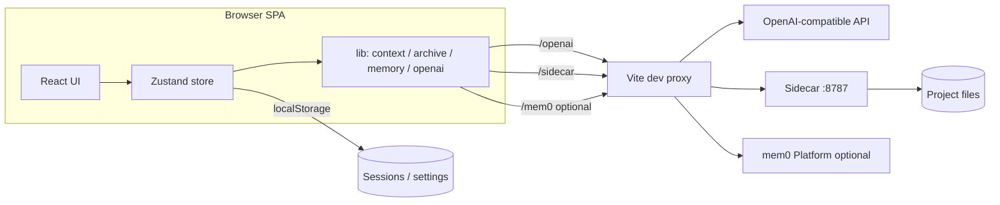
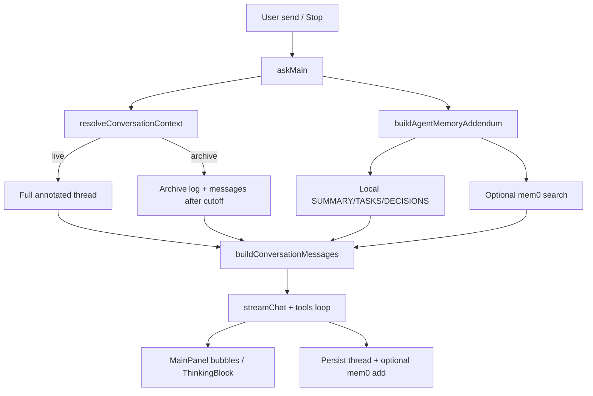

# ForkNote

面向开发与排障的「边读边澄清、再归档成日志」的工作台。

**Clarify as you read** — 针对 AI 长回答的选中澄清工具。

拖选一段文字 → **Clarify this** → 浮动澄清面板与 Fork 分支回答；对分点打 **Accept / Reject / Doubt**；右侧 **Branch rail** 导航；可选绑定本机目录做读写。

- 纯 Web（Vite + React）
- OpenAI 兼容 API（云端或本机 Ollama / LM Studio 等）
- **多笔记**：左侧列表新建 / 重命名 / 切换 / 删除
- 无登录；笔记与设置保存在浏览器 `localStorage`

---

## 安装与运行

```bash
npm install
cp .env.example .env.local   # 可选，也可只在页面 API Settings 里填
npm run dev                  # 前端，通常 http://localhost:5173
```

若要用 **本地项目读写**（agent 工具），再开一个终端：

```bash
npm run sidecar              # http://127.0.0.1:8787；开发时经 Vite 代理 /sidecar
```

| 脚本 | 作用 |
|------|------|
| `npm run dev` | Vite 开发服务器 |
| `npm run sidecar` | 本机 FS sidecar（**项目工具必需**） |
| `npm run build` | 类型检查 + 生产构建 |
| `npm run preview` | 预览构建产物 |

---

## 系统设置

侧栏打开 **Settings**（系统设置），左侧分类：

| 分类 | 内容 |
|------|------|
| **General** | 主题 Light / Dark / System；界面语言 English / 中文（模型回复语言跟随） |
| **API** | 提供商预设、Base URL / Model / Key、开发代理；上下文记忆包与可选 mem0 |
| **Data** | 导出 / 导入笔记 JSON；清空本地笔记 |
| **Project** | Sidecar URL、打开本地项目 |
| **About** | 产品说明 |

### API

1. 点预设芯片（如 **Ollama**、**LM Studio**、**DeepSeek**），或手动填 **Base URL** / **Model** / **API Key**
2. 本机服务一般 **API Key 留空**；云端填控制台密钥
3. 开发时勾选 **Use local proxy in development**（推荐）：请求走 `/openai/...`，由 Vite 按当前 Base URL 转发，减轻 CORS
4. **Save** 保存（亦写入 `localStorage`）

| 常见本机 | Base URL | Model 示例 |
|----------|----------|------------|
| Ollama | `http://127.0.0.1:11434` | `llama3.2`、`qwen2.5:7b`（须与 `ollama list` 一致） |
| LM Studio | `http://127.0.0.1:1234` | Local Server 里显示的名称 |

自测 Ollama：

```bash
curl http://127.0.0.1:11434/v1/chat/completions \
  -H "Content-Type: application/json" \
  -d '{"model":"llama3.2","messages":[{"role":"user","content":"hi"}],"stream":false}'
```

curl 成功而页面失败时，核对 Model 名、端口、是否启用代理。

---

## 主对话

1. 在输入框提问 → **Send**（`Enter` 发送，`Shift+Enter` 换行）
2. 生成中按钮变为 **Stop**：中止流式输出
3. **Stop** 后，刚才发出的提示会 **恢复到输入框**，便于改写再发
4. 有对话后，底部为紧凑续写框；空笔记页有「Clarify as you read」引导

---

## 归档与上下文模式

澄清与分点裁决完成后，可把主线压成一篇开发日志草稿，再选上下文继续聊：

1. 输入区上方工具栏点 **Archive** → 模型根据主线 + 裁决 + 澄清整理 Markdown 日志
2. 同排分段控件：**Archive context**（以日志为底座，只附归档之后的新消息）/ **Full thread**（整条 thread）
3. 提示文案在按钮上方，避免切换模式时工具栏跳动；生成中可用 **Stop** 取消
4. 多篇归档时在归档面板中选用

---

## 选中澄清与 Fork 面板

1. 在助手回答中 **拖选** 一段文字
2. 出现工具条 → 点 **Clarify this**
3. 弹出 **Clarify selection**：简短说明哪里不清 → **Submit**
4. 澄清回答以浮动 **Fork** 面板挂在选区附近；可继续在分支里选中澄清（嵌套）
5. 关闭面板或点 Branch rail / 评论轨上的节点，可重新打开对应分支

提示：澄清宜短，少引入新概念。

---

## 分点裁决（Point verdicts）

当回答含至少两个 `【1】【2】…` 分点时，每点旁可裁决：

| 操作 | UI | 含义（进入后续上下文） |
|------|-----|------------------------|
| 默认 / **Accept** | 未点或采纳 | 视为已采纳，正文保留 |
| **Reject** | 拒绝 | 后续对话省略该点正文 |
| **Doubt** | 存疑 | 保留正文；可填 **Doubt note** |

未标记的点按 **采纳** 处理。裁决会影响后续主对话 / 澄清的上下文组装。

---

## Branch rail

主回答右侧为 git-graph 风格的 **Branch rail**：

- 主干对齐各条助手消息；Fork 节点按深度向右展开
- 点击节点可聚焦 / 打开对应浮动分支面板
- 与左侧评论轨、浮动层配合，用于在长回答里跳转澄清分支

---

## 打开项目与 Agent 工具

主对话可绑定本机目录，模型通过工具 **列出 / 读取 / 写入 / 搜索** 文件（路径限制在项目根内）。

### 步骤

1. 先运行 `npm run sidecar`，再 `npm run dev`
2. 侧栏或输入区上方点 **Open project** → 对话框 **Local project**
3. **Sidecar URL** 默认 `/sidecar`（经 Vite 代理）；填项目 **绝对路径** → **Connect**
4. 路径记在 `localStorage`；下次若 sidecar 已开可自动重连
5. **Disconnect** 解除绑定

### 工具能力

| 工具 | 作用 |
|------|------|
| `list_dir` | 列目录 |
| `read_file` | 读文本（有大小上限） |
| `write_file` | 覆盖写入 UTF-8 文本文件（源码、md、csv、json 等） |
| `search_replace` | 精确替换已有文本文件中的片段（优先用于小改动） |
| `apply_patch` | 对同一文件顺序应用多处 `search_replace` |
| `write_docx` | 生成真实 Word `.docx`（`title` + `paragraphs`） |
| `write_xlsx` | 生成真实 Excel `.xlsx`（`rows` 二维数组） |
| `mkdir` | 创建目录 |
| `search_files` | 简单全文搜索 |

一轮内最多约 **8** 轮工具往返。活动日志与 **Changes this turn** 显示本轮读/写过的路径；可 **Clear log**。

示例提问：

> 读取 package.json，并在 README.md 顶部加一行说明本项目用途

### Sidecar HTTP（`127.0.0.1:8787`）

| Method | Path | 说明 |
|--------|------|------|
| `POST` | `/project/open` | `{ "path": "/abs/project" }` |
| `GET` | `/project` | 当前根目录 |
| `POST` | `/project/close` | 解除绑定 |
| `GET` | `/fs/list?path=` | 列目录 |
| `GET` | `/fs/read?path=` | 读文件 |
| `POST` | `/fs/write` | `{ "path", "content" }` 文本 |
| `POST` | `/fs/search_replace` | `{ "path", "old_string", "new_string", "replace_all?" }` |
| `POST` | `/fs/apply_patch` | `{ "path", "edits": [{ "old_string", "new_string", "replace_all?" }] }` |
| `POST` | `/fs/write_docx` | `{ "path", "title?", "paragraphs": string[] }` |
| `POST` | `/fs/write_xlsx` | `{ "path", "sheet_name?", "rows": cell[][] }` |
| `POST` | `/fs/mkdir` | `{ "path" }` |
| `POST` | `/fs/search` | `{ "query", "path?" }` |
| `GET` | `/health` | 探活 |

安全：拒绝 `..` 与绝对路径逃逸；FS 操作必须落在绑定根下。

---

## 主题与笔记

- **Light / Dark / System**：系统设置 General 或侧栏；偏好键 `forknote-theme`
- **New note**：新建空笔记
- **重命名**：双击笔记标题，或菜单里重命名；手动命名后标题不再被首条消息自动覆盖
- **删除**：笔记菜单删除（数据在本地，无云端回收站）
- 笔记按日期分组显示在左侧

---

## 环境变量（`.env.local`）

从 `.env.example` 复制即可。均为可选；页面 **API Settings** 可覆盖。

| 变量 | 说明 |
|------|------|
| `VITE_OPENAI_BASE_URL` | 如 `http://127.0.0.1:11434` 或 `https://api.deepseek.com` |
| `VITE_OPENAI_API_KEY` | 可选；本地常留空 |
| `VITE_OPENAI_MODEL` | 如 `llama3.2`、`deepseek-chat` |
| `VITE_MEM0_API_KEY` | 可选；mem0 Platform key（默认关闭记忆） |
| `VITE_MEM0_HOST` | 可选；默认 `https://api.mem0.ai` |

生产构建（`npm run build`）部署到静态站时，需自行配置反向代理，或关闭代理并确保 API 允许跨域。

---

## 上下文记忆包（推荐本地优先）

目标流水线：

```
聊天记录
  → LLM 压缩（Compress / 可选归档后自动）
  → SUMMARY.md + TASKS.md + DECISIONS.md
  → （可选）mem0 云检索
  → 下次 askMain 自动注入 system 附加段
```

### 怎么用

1. 聊几轮后点输入区上方 **Compress context**（或 Settings → API 勾选 **Also compress after Archive**）
2. **已绑定项目**：写入 `{memoryDir}/`（默认 `.forknote/memory/`）三份 Markdown  
   **未绑定项目**：草稿保存在当前笔记的 `contextMemory`（localStorage）
3. 下次主对话发送前，会把相关摘录（本地关键词筛选）注入上下文；若开启 mem0，再叠加云端 search hits
4. Settings → API → **Context memory pack**：注入开关、归档后压缩、记忆目录

实现：`src/lib/contextMemory.ts` + `compressContext`（store）。压缩提示与归档类似，复用 `streamChat`。

### 可选 mem0 云（叠加层）

默认关闭。开启后：

1. [mem0 Platform](https://app.mem0.ai) 拿 API Key → Settings → **Long-term (mem0 cloud)**
2. 开发环境勾 **Use local proxy** 时走 Vite `/mem0`
3. 写入：主对话成功后、Archive、以及 Compress 成功后的 pack 同步  
4. 读取：与本地 MD 包一起注入

薄 `fetch` 适配器（`src/lib/mem0.ts`），**未**依赖 `mem0ai` npm。失败只 `console.warn`。

| 模式 | 数据去向 | 适合 |
|------|----------|------|
| **仅 MD 包（推荐）** | 项目磁盘或笔记草稿 | 本地优先 |
| **MD + mem0** | 本地文件 + 云检索 | 跨设备长期记忆 |
| **自托管 mem0 OSS** | sidecar 代理（未实现） | 完全自管向量库 |

LangMem / 向量嵌入本地检索：未做；当前本地层是三文件 + 关键词摘录。后续可在 sidecar 加嵌入搜索。

---

## 软件架构

ForkNote 是浏览器端 SPA + 可选本机 sidecar。无自有后端；对话状态与设置落在 `localStorage`，LLM 走 OpenAI 兼容 HTTP，项目文件经 sidecar 受限访问。

### 运行时拓扑



### 主对话数据流



### 分层与职责

| 层 | 位置 | 职责 |
|----|------|------|
| **UI** | `src/components/` | 会话壳、主聊天、澄清浮层、Branch rail、系统设置、归档面板 |
| **状态** | `src/store/useAppStore.ts` | 会话 CRUD、`askMain` / `askBranch`、归档 / 压缩、项目绑定、生成中止 |
| **领域 lib** | `src/lib/` | 上下文组装、裁决标注、流式协议、agent 工具、记忆、i18n、主题 |
| **持久化** | `storage.ts` / `settings.ts` / `theme.ts` | `localStorage` 笔记、API、主题、语言 |
| **Sidecar** | `sidecar/index.js` | 本机项目根绑定与受限 FS HTTP |
| **代理** | `vite.config.ts` | 开发期 `/openai`、`/sidecar`、`/mem0` 转发 |

### 核心模块

| 模块 | 文件 | 说明 |
|------|------|------|
| 主聊天壳 | `MainPanel.tsx`、`ChatComposer.tsx` | 消息列表、footer 工具栏（项目 / 上下文模式 / Archive / Compress）、DeepSeek 风格气泡 |
| 澄清 / 分点 | `SelectableMarkdown.tsx`、`PointizedAnswer.tsx`、`FloatingAskPanel.tsx` | 选中澄清、分点 Accept/Reject/Doubt |
| 分支导航 | `BranchRail.tsx`、`BranchFloatLayer.tsx` | git-graph 轨与浮动 Fork |
| 上下文 | `conversationContext.ts`、`contextBuilder.ts`、`points.ts` | live vs archive；system + 历史；裁决注入 |
| 归档 | `archive.ts`、`ArchivePanel.tsx` | 开发日志草稿与面板 |
| 记忆包 | `contextMemory.ts` | Compress → 三 MD；`askMain` 注入 |
| mem0 | `mem0.ts` | 可选云检索 / 写入（默认关） |
| 推理展示 | `openai.ts`、`reasoning.ts`、`ThinkingBlock.tsx` | 仅在有真实 reasoning 时显示 |
| Agent 工具 | `agentTools.ts`、`sidecar.ts` | `list_dir` / `read_file` / `write_file` / … |
| 设置 / i18n | `SettingsPanel.tsx`、`i18n.ts`、`theme.ts` | 系统设置；EN/ZH；主题 |
| 类型 | `types.ts` | `ChatSession`、`ThreadRoot`、归档、记忆包等 |

### 持久化键（摘要）

| 键 / 位置 | 内容 |
|-----------|------|
| `forknote-sessions-v1` | 多笔记、thread、archives、contextMemory |
| `forknote-settings` 等 | API、代理、记忆 / mem0 开关 |
| `forknote-theme` / `forknote-locale` | 主题与界面语言 |
| 项目偏好 | 上次项目路径、sidecar URL |
| 磁盘 `.forknote/memory/` | 绑定项目后的 SUMMARY / TASKS / DECISIONS |

### 项目结构

```
sidecar/                 # 本机 FS sidecar（Node HTTP :8787）
public/                  # favicon 等
src/
  App.tsx                # 壳：侧栏 + 主区 + 设置 / 项目 / 归档浮层
  main.tsx
  types.ts
  components/            # UI（见上表）
  lib/                   # 协议与领域逻辑（见上表）
  store/useAppStore.ts   # 唯一应用状态入口
  index.css              # 设计 token 与布局
vite.config.ts           # 开发代理
```

### 设计约束（现行）

- **本地优先**：笔记默认不出浏览器；mem0 与云 API 为可选
- **上下文显式**：Full thread / Archive / 记忆包注入路径可预期，避免「假记忆」
- **工具隔离**：项目工具仅主对话；路径相对项目根，sidecar 防逃逸
- **推理诚实**：无 `reasoning` / think 标签则不展示思考 UI
